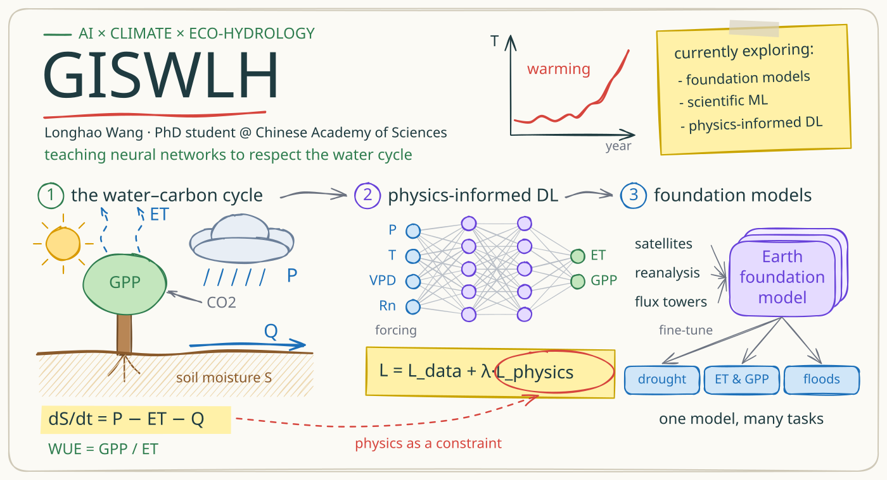

<!-- readme-visual-refresh:banner -->

<!-- /readme-visual-refresh:banner -->

- 👋 Hi, I’m Longhao Wang. PHD. student in Chinese Academy of Science
- 👀 I’m working on climate change and eco-hydrology using deep learning method
- 🌱 I’m currently learning HTML\JS
- 📫 How to reach me:
- RG: https://www.researchgate.net/profile/Longhao-Wang
- Google Scholar: https://scholar.google.com/citations?user=ei3oenUAAAAJ&hl=zh-CN&oi=ao

* I'm working on the carbon water coupling models for ecohydrology applications. I'm interested in AI methods, climate change and water cycle.
<!---
GISWLH/GISWLH is a ✨ special ✨ repository because its `README.md` (this file) appears on your GitHub profile.
You can click the Preview link to take a look at your changes.
--->

<!-- readme-visual-refresh:artwork-source -->
[Editable banner artwork · Excalidraw](assets/readme/banner.excalidraw)
<!-- /readme-visual-refresh:artwork-source -->
